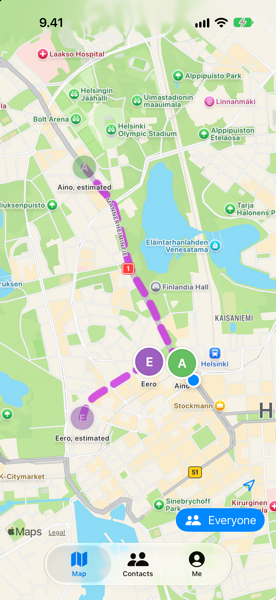
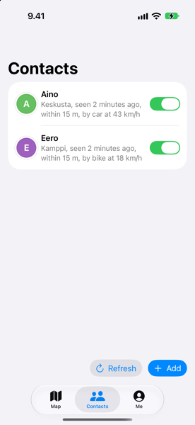
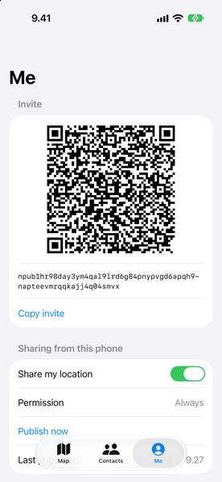
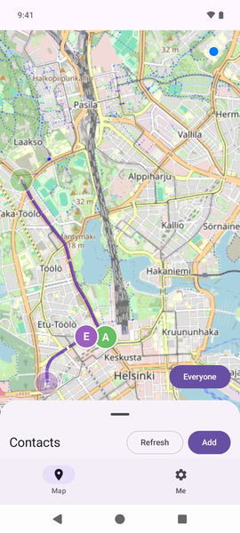
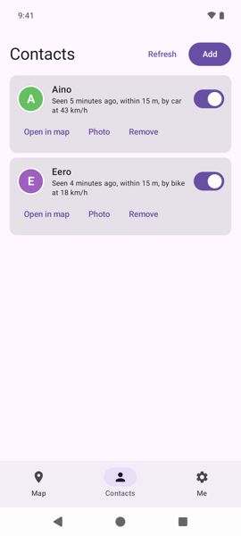
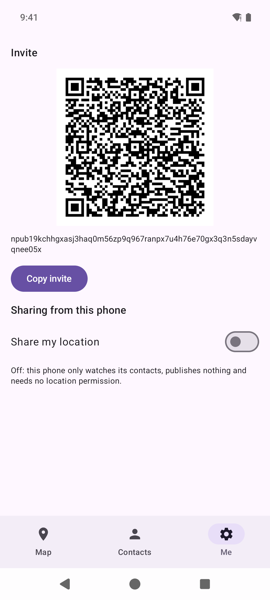

# Mismeet

Location sharing in the style of Find My, built on Nostr, for iOS and Android. Each phone
publishes its own location to Nostr relays as one addressable event, encrypted separately for
each approved contact and carrying an expiration. Contacts fetch the latest event when they want
to see where someone is. There is no server of its own, no push service and no bridge, and the
social graph never appears in plaintext. The Android app has no Google Play Services dependency,
so it runs on GrapheneOS as well as on stock Android.

## Screenshots

Taken on the iPhone 17 simulator and the API 36 emulator with two fake contacts published from
the Mac, as described under Testing without a second phone.

| | Map | Contacts | Me |
| --- | --- | --- | --- |
| iOS |  |  |  |
| Android |  |  |  |

## Status

The protocol is specified and both apps build with the protocol core and its conformance
tests, a device key, local contact and relay storage, relay publishing and fetching, location
monitoring and a first set of screens. Neither app has been exercised end to end on a phone
yet. Invites are scanned as QR codes or pasted as text.

## Files

- [`spec/SPEC.md`](spec/SPEC.md): the protocol: event kind and tags, encryption and padding,
  expiration, relay handling, the contact model, client behaviour and the threat model.
- [`CLAUDE.md`](CLAUDE.md): the rules and the commands Claude Code follows in this repository.
- `ios/`: the Swift and SwiftUI app, generated from `ios/project.yml` with XcodeGen.
- `android/`: the Kotlin app and the `protocol` module it builds on.
- `design/`: the icon sketch, the script that turns it into both apps' icons and the store
  icon, and the screenshots above.
- [`scripts/release.sh`](scripts/release.sh): tags store builds and checks that a release build
  comes from its tag, see Distribution.
- [`scripts/check-dco.sh`](scripts/check-dco.sh) and
  [`.github/workflows/dco.yml`](.github/workflows/dco.yml): the sign-off check CI runs on pull
  requests and on pushes to `main`, see CONTRIBUTING.md.
- [`zapstore.yaml`](zapstore.yaml) and [`CHANGELOG.md`](CHANGELOG.md): the Zapstore listing and
  the release notes it reads.
- [`CONTRIBUTING.md`](CONTRIBUTING.md): the terms contributions come under and the sign-off
  every commit needs.
- [`PRIVACY.md`](PRIVACY.md): the privacy policy the store listings link to.
- [`LICENSE`](LICENSE), [`LICENSE-APP-STORE-EXCEPTION`](LICENSE-APP-STORE-EXCEPTION) and
  [`LICENSE-CC-BY-SA-4.0`](LICENSE-CC-BY-SA-4.0): the licence texts, see below.

## Development

Run the commands in this section and the next from the root of your checkout.

### Requirements

- iOS: a Mac with Xcode 27 (the iOS 27 SDK; the deployment target is iOS 18), `xcodegen` and
  `xcbeautify` from Homebrew, an Apple ID (a free one is enough: the app uses no push and no
  special entitlement) and an iPhone on iOS 18 or later. The test device is an iPhone XR.
- Android: a JDK 17 or later (Temurin 21 here), the Android command line tools with
  `platforms;android-36`, `build-tools;36.0.0` and `platform-tools`, and a phone on Android 12
  or later. The test devices are a phone on GrapheneOS and a Motorola Moto G200 5G on Android
  12. Gradle comes from the checked-in wrapper; no Android Studio is needed.

### Set up once: iOS

1. Sign in to Xcode with the Apple ID under Xcode > Settings > Apple Accounts. Signing in
   alone creates nothing: a free account gets its personal team, certificate and profile only
   once a project asks for them, so `security find-identity` shows no identity yet.

2. Generate the project and open it in Xcode:

   ```bash
   xcodegen generate --spec ios/project.yml && open ios/Mismeet.xcodeproj
   ```

   Select the Mismeet target, then Signing & Capabilities, and pick the team named after you
   with "(Personal Team)". Xcode registers the app id and creates the development certificate
   and profile. Do the same for the MismeetTests target. Xcode writes the team id into the
   generated project; copy it to `ios/.team-id` (git-ignored, one line), which the command
   line builds read, since the next `xcodegen generate` discards the project's copy:

   ```bash
   grep -m1 -oE 'DEVELOPMENT_TEAM = [A-Z0-9]{10}' ios/Mismeet.xcodeproj/project.pbxproj | cut -d' ' -f3 | tee ios/.team-id
   ```

3. On the iPhone, enable Settings > Privacy & Security > Developer Mode, connect it by USB and
   trust the Mac. List it, then write its identifier (the first column) to `ios/.device-id`
   (git-ignored, one line):

   ```bash
   xcrun devicectl list devices
   ```

### Set up once: Android

1. Point Gradle at the SDK (`android/local.properties` is git-ignored); the path below is the
   Homebrew one:

   ```bash
   printf 'sdk.dir=/opt/homebrew/share/android-commandlinetools\n' > android/local.properties
   ```

2. Put `adb` on the PATH:

   ```bash
   ln -s /opt/homebrew/share/android-commandlinetools/platform-tools/adb /opt/homebrew/bin/adb
   ```

3. On the phone: Settings > About phone, tap Build number seven times, then Settings > System >
   Developer options > USB debugging. Connect by USB with a data cable (a charge-only cable
   leaves the phone invisible), choose "File transfer" when the phone asks what the USB
   connection is for, and accept the "Allow USB debugging?" prompt that shows the Mac's
   fingerprint, ticking "Always allow from this computer". Check that the phone shows as
   `device`; `unauthorized` means the prompt is still waiting on the phone, and an empty
   list means the cable, the port or USB debugging:

   ```bash
   adb devices
   ```

### Android emulator

An emulator image without Google APIs, in line with the app's independence from Play Services.
Install the emulator and the image once, and create a virtual device:

```bash
sdkmanager "emulator" "system-images;android-36;default;arm64-v8a"
```

```bash
avdmanager create avd --name mismeet --package "system-images;android-36;default;arm64-v8a" --device pixel_7
```

Start it; it keeps running in that terminal, and `-no-window` runs it without a window:

```bash
/opt/homebrew/share/android-commandlinetools/emulator/emulator -avd mismeet
```

It then counts as the connected phone for the install and launch commands below. Set its
position (longitude first) and take a screenshot:

```bash
adb emu geo fix 24.9384 60.1699
```

```bash
adb exec-out screencap -p > emulator.png
```

### Testing without a second phone

A fake publisher on the Mac stands in for the iPhone. The watching app prints its own invite
at launch, `Invite: nostr:nprofile...`, to logcat on Android and to the simulator's log on iOS,
and shows it on the Me screen:

```bash
adb logcat -d -s Mismeet:I
```

```bash
xcrun simctl spawn booted log show --info --last 5m --predicate 'subsystem == "app.mismeet.ios"'
```

Publish a location for that invite; the tool prints the fake publisher's own invite and a QR
code to add on the watching app, and keeps its key under `android/protocol/build/` so that
later runs move the same contact. `MISMEET_FAKE_NAME=other` in the environment makes a second
publisher, and several readers go comma-separated:

```bash
android/gradlew -p android -q :protocol:fakePublish -PfakeArgs="<invite> 60.1699 24.9384"
```

Debug builds also take contacts at launch, so the simulator and the emulator need no typing;
the invites are separated by semicolons:

```bash
SIMCTL_CHILD_MISMEET_TEST_INVITES="<invite>;<invite>" xcrun simctl launch booted app.mismeet.ios
```

An entry may carry a name, `Aino|<invite>`; without one the contact is named Test 1, Test 2 and
so on. On the simulator, `SIMCTL_CHILD_MISMEET_TEST_TAB=contacts` or `me` in the same way
opens that tab instead of the map, which is how the screenshots above were taken.

```bash
adb shell "am start -n app.mismeet.android/.MainActivity --es invites '<invite>;<invite>'"
```

### Build, test and run

iOS, after cloning and after every edit to `ios/project.yml`:

```bash
xcodegen generate --spec ios/project.yml
```

Build for the simulator (`xcrun simctl list devices available` lists the simulators; the
generic destination builds without booting one):

```bash
set -o pipefail && xcodebuild -project ios/Mismeet.xcodeproj -scheme Mismeet -destination 'platform=iOS Simulator,name=iPhone 17' -derivedDataPath ios/build build | xcbeautify
```

Unit tests:

```bash
set -o pipefail && xcodebuild -project ios/Mismeet.xcodeproj -scheme Mismeet -destination 'platform=iOS Simulator,name=iPhone 17' -derivedDataPath ios/build test | xcbeautify
```

Run on the simulator: boot one, show it, build for it as above, then install and launch:

```bash
xcrun simctl bootstatus "iPhone 17" -b && open -a Simulator
```

```bash
xcrun simctl install booted ios/build/Build/Products/Debug-iphonesimulator/Mismeet.app && xcrun simctl launch booted app.mismeet.ios
```

Build for the connected iPhone. The destination names the phone on purpose: a free team has
no registered devices, and only a build for a specific device registers it and creates the
provisioning profile; a `generic/platform=iOS` build fails with "no devices".

```bash
set -o pipefail && xcodebuild -project ios/Mismeet.xcodeproj -scheme Mismeet -destination "platform=iOS,id=$(cat ios/.device-id)" -derivedDataPath ios/build -allowProvisioningUpdates DEVELOPMENT_TEAM="$(cat ios/.team-id)" build | xcbeautify
```

Install and launch on the device (add `--console` to the launch to stream its output). The
first launch is refused until the phone trusts the personal team: Settings > General > VPN &
Device Management, tap the developer app entry, Trust. After that, launching works.

```bash
xcrun devicectl device install app --device "$(cat ios/.device-id)" ios/build/Build/Products/Debug-iphoneos/Mismeet.app && xcrun devicectl device process launch --device "$(cat ios/.device-id)" --terminate-existing app.mismeet.ios
```

Android, build:

```bash
android/gradlew -p android assembleDebug
```

Lint and unit tests:

```bash
android/gradlew -p android lint test
```

Install and launch on the phone:

```bash
android/gradlew -p android installDebug && adb shell am start -n app.mismeet.android/.MainActivity
```

Logs:

```bash
adb logcat --pid="$(adb shell pidof -s app.mismeet.android)"
```

### Notes

- Free Apple ID: the provisioning profile expires after seven days, so rebuild and reinstall
  weekly, and at most ten app ids can be registered per seven days.
- GrapheneOS has no Google location services: the app uses GPS, and the network provider only
  when GrapheneOS's own network location is turned on in Settings.
- Stock Android, and Android 12 in particular, stops background services it considers
  wasteful. The Me screen offers the battery optimisation exemption; grant it, or the sharing
  service will not survive the screen being off for long.
- Android asks for location "while in use" first and "all the time" only from the app's
  settings page; the Me screen walks through both, but only once "Share my location" is on.
  Off, which is the default, the phone only watches its contacts and needs no permission
  beyond the camera for scanning a QR code.

### First test between two phones

The iPhone publishes and the Android phone watches. Each phone scans the other's invite once:
the iPhone's scan tells it whom to encrypt for, the Android phone's scan tells it whose events
to fetch.

1. On the iPhone, open Me, tap "Allow location" and grant it, then "Allow location" again for
   "Always". The log on the same screen shows "Relay list: accepted by N of 3 relays".
2. On the Android phone, open Me: its invite QR code is on screen. On the iPhone, Contacts >
   "+" > "Scan QR code", scan it, give the contact a name and tap Add. The iPhone log shows
   "Location: accepted by N of 3 relays" within a few seconds.
3. On the iPhone, open Me to show its QR code. On the Android phone, Contacts > Add > "Scan QR
   code", allow the camera, scan it, name the contact, Add. The row shows "Seen ... within N m"
   after the next refresh, within a minute, or at once with Refresh. Both apps open on the map,
   framed around everyone with a known position; "Everyone" frames them again after panning.
4. Walk a few hundred metres with the iPhone, or drive. Significant location changes wake the
   app and the Android row's "Seen" time moves. Pulling the Contacts list down on the iPhone
   refreshes its own view; the "Publish now" button on its Me screen forces a publish.
5. To check revocation, switch "Share my location" off for the contact on the iPhone: the next
   refresh on the Android phone shows "no longer sharing", with the last position kept.

## Distribution

Android is published on [Zapstore](https://zapstore.dev), the Nostr app store, and not on
F-Droid. iOS goes to the App Store. Anyone who would rather avoid the App Store builds and
installs the iOS app from source, as under Development above; a free Apple ID is enough, and
such a build runs for seven days before it needs reinstalling.

### Store builds are tagged

Every build that goes to a store is made from an annotated git tag named
`<platform>-<version>-<build>`, such as `android-0.1.0-1` or `ios-0.1.0-1`, so the source of
any published binary is exactly the tagged commit. The version and build number come from
`versionName` and `versionCode` in `android/app/build.gradle.kts` and from
`MARKETING_VERSION` and `CURRENT_PROJECT_VERSION` in `ios/project.yml`. `scripts/release.sh`
creates and pushes the tag, and the release builds refuse to run unless the tree is clean and
`HEAD` is that tag. Each release also gets a section in [`CHANGELOG.md`](CHANGELOG.md).

### Android on Zapstore

Once, create the release key outside the repository and keep a backup: Zapstore links the
key's certificate to the publisher's Nostr identity, and updates must carry the same
signature, so a lost key means a new listing.

```bash
keytool -genkeypair -keystore ~/keys/mismeet-release.jks -storetype PKCS12 -alias mismeet -keyalg RSA -keysize 4096 -validity 10000
```

Point the build at it in `android/keystore.properties`, which git ignores, with the passwords
`keytool` asked for:

```bash
cat > android/keystore.properties <<'PROPS'
storeFile=/Users/you/keys/mismeet-release.jks
storePassword=...
keyAlias=mismeet
keyPassword=...
PROPS
```

Install `zsp`, Zapstore's publishing tool, with Go, which puts it in `~/go/bin`, or take a
binary from its [releases](https://github.com/zapstore/zsp/releases):

```bash
brew install go && go install github.com/zapstore/zsp@latest
```

Put the publishing npub into the `pubkey` line of [`zapstore.yaml`](zapstore.yaml), then
commit and push it: the Zapstore relay reads that file from the repository to whitelist the
publisher on the first release.

For each release:

1. Raise `versionCode` and `versionName` in `android/app/build.gradle.kts`, add the version's
   section to `CHANGELOG.md`, commit and push to `main`.
2. Tag the commit and push the tag:

   ```bash
   scripts/release.sh tag android
   ```

3. Build the signed APK from the tag:

   ```bash
   android/gradlew -p android assembleRelease
   ```

4. Publish with your own key. `SIGN_WITH=browser` signs through a NIP-07 browser extension
   such as nos2x-fox: `zsp` serves a signing page on `http://localhost:17007/` and opens it in
   the default browser. When the extension lives in another browser or Firefox profile, open
   that address there and approve each event the extension asks about. A NIP-46 `bunker://`
   URL works as well. On the first publish `zsp` asks for the keystore to link its
   certificate to your npub.

   ```bash
   SIGN_WITH=browser ~/go/bin/zsp publish --commit "$(git rev-parse HEAD)" zapstore.yaml
   ```

`android/gradlew -p android assembleRelease -PuntaggedRelease` skips the tag check to try out
the signing setup; never publish what it builds.

### iOS on TestFlight and the App Store

Uploading needs a paid Apple Developer Program membership; the free personal team used for
development cannot distribute. Every upload goes to App Store Connect, where it is a TestFlight
build first. A release to the App Store submits one of those tested builds for review, so the
binary users get is the one that was tested, and it is already tagged.

Once, after the membership is active:

1. Find the team id under Membership details at <https://developer.apple.com/account> and
   write it to `ios/.team-id`, with your id in place of `ABCDE12345`. An individual
   membership can keep the id of the free personal team, and Xcode may go on calling it
   Personal Team; activation can take up to two days after payment.

   ```bash
   echo ABCDE12345 > ios/.team-id
   ```

2. Build for the iPhone with the device build command under Development. That registers the
   bundle id `app.mismeet.ios` under the team, and once the membership is active the
   development profile it fetches lasts a year instead of seven days. If Xcode answers that
   the id "is not available", another team holds it, and the bundle id has to change.
3. In App Store Connect (<https://appstoreconnect.apple.com>), open Apps, click "+" and then
   New App. Choose iOS, the name Mismeet (names are unique on the store, so another may be
   needed), the bundle id `app.mismeet.ios`, and the SKU `mismeet`.

For each build:

1. Raise `CURRENT_PROJECT_VERSION` in `ios/project.yml`, since every upload needs a new build
   number, and `MARKETING_VERSION` too when it starts a new version. Add the version to
   `CHANGELOG.md`, commit and push to `main`.
2. Tag the commit and push the tag:

   ```bash
   scripts/release.sh tag ios
   ```

3. Archive from the tag and upload it. Xcode creates the distribution certificate and the App
   Store profile on the first run:

   ```bash
   scripts/release.sh upload-ios
   ```

4. Wait until App Store Connect has processed the build, usually minutes, then open the app's
   TestFlight tab. The first build asks the export compliance question there: the app
   encrypts locations end to end with NIP-44 (ChaCha20 and secp256k1), beyond the operating
   system's encryption, and the Info.plist leaves the answer to you.
5. Under Internal Testing, add yourself as a tester. Install TestFlight from the App Store on
   the iPhone and install the build from it. TestFlight builds expire after 90 days.

To release a tested build on the App Store:

1. In App Store Connect, open the app's version page under iOS App, creating the version if it
   is not there. Upload the screenshots from `design/app-store/iphone-6.9` for the large
   display and `design/app-store/iphone-6.3` for the medium one, and fill in the description,
   keywords, the support URL (this repository works), the privacy policy URL
   <https://github.com/lambdakilo/mismeet/blob/main/PRIVACY.md>, the App Privacy answers, the
   age rating and the category.
2. Under Build, choose the TestFlight build you tested.
3. In App Review Information, explain the "Always" location: the app publishes on significant
   location changes while closed, to the contacts the user chose. Then click Add for Review
   and submit. Once approved, the version goes live when you release it.

The screenshots come from the iPhone 18 Pro Max and iPhone 17 simulators with a fixed status
bar and the contacts Aino and Eero published by the fake publisher.

## License

Prose, meaning `spec/SPEC.md`, `CLAUDE.md`, `CONTRIBUTING.md`, `CHANGELOG.md`, `PRIVACY.md`
and this README, is licensed under Creative Commons Attribution-ShareAlike 4.0 International. See
[`LICENSE-CC-BY-SA-4.0`](LICENSE-CC-BY-SA-4.0).

Everything else is licensed under the GNU Affero General Public License, version 3 or (at your
option) any later version, with an app store exception. See [`LICENSE`](LICENSE) and
[`LICENSE-APP-STORE-EXCEPTION`](LICENSE-APP-STORE-EXCEPTION):

> As an additional permission under section 7 of the GNU Affero General Public License,
> version 3, you are allowed to distribute the software through an app store, including
> Apple's App Store, even if that store has restrictive terms and conditions that are
> incompatible with the AGPL, provided that the source is also available under the AGPL with
> or without this permission through a channel without those restrictive terms and
> conditions.

Contributions come under the same terms, with a Developer Certificate of Origin sign-off on
every commit and no contributor licence agreement. See [`CONTRIBUTING.md`](CONTRIBUTING.md).
